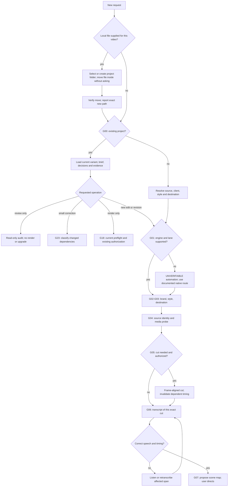
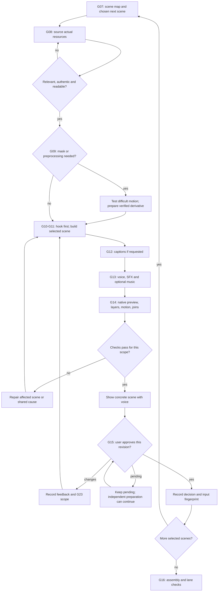
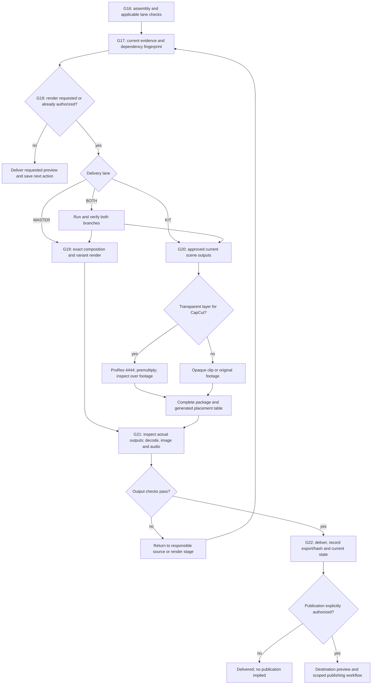
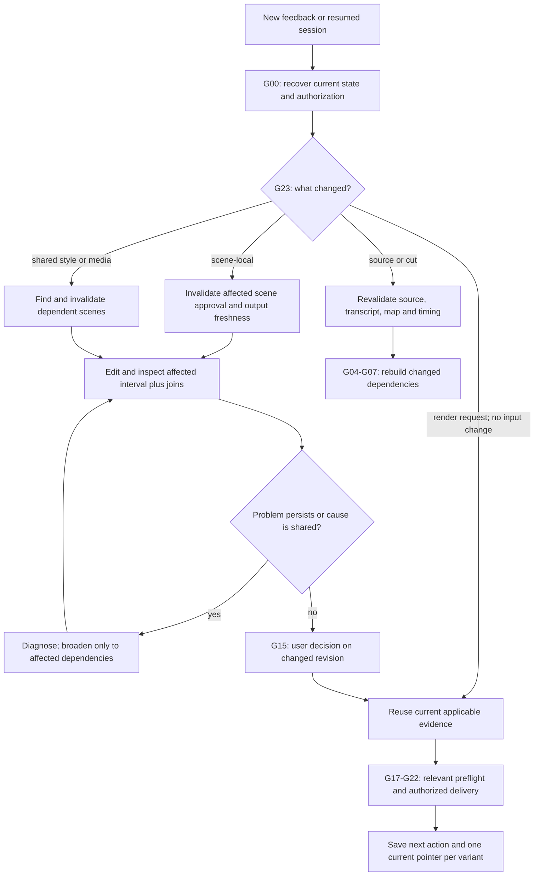

# Detailed video pipeline workflow

Updated 20-sep-2026: file intake, scaffold adoption and final readiness review. [44-test review and Enzo handoff](PIPELINE-READINESS-2026-09-20.md). [Interactive diagram](PIPELINE-WORKFLOW.html) · [Commands](PIPELINE-OPERATIONS.md) · [Styles](EDITING_STYLES.md).

The 24 gates below distinguish automated checks from human/editorial review. Implementing a receipt does not automate taste, transcription accuracy or listening. The original audit is preserved in `.audit/video-pipeline-2026-09-19.json`; implementation evidence and regression results are in `.audit/`.

Start: supplied local file → select/create video folder → move into the project without confirmation → verify and report the new path → exact project/variant → existing state → only applicable gates. A small correction skips fresh intake; a render request reuses current preview evidence. User decisions and authorization persist.

Status exits: 0 applicable checks passed/historical delivery intact; 1 failure; 2 pending/unverifiable. Fast mode lists omitted checks. Old project defects remain visible without reopening delivered videos.

## Entry and routing

## Scene loop

## Delivery branches

## Correction and resume

## G00 · Resume and task scope

Coverage: **mixed**. Owner: Agent.

**Applies:** Every request, including corrections and render-only requests.

**Pass:** For a newly supplied local input, first select/create the video folder, move the recording into originales/ (supporting assets into recursos/), verify the move and immediately report its exact new path. This routine move is authorized and does not wait for creative decisions. Then recover the exact project/variant, latest direction, approval scope, current export and next task.

**If missing or failed:** If the project cannot be identified from context, create a clearly labeled provisional project under proyectos/por-clasificar/, move the input there and report that location; resolve missing routing facts afterward. Do not write into an ambiguous existing project. Report actual missing-file or filesystem errors instead of claiming a successful move.

**Evidence/tooling:** ENTRADA-DE-ARCHIVOS.md is the mandatory agent intake procedure. PROYECTO.json records the centralized location and provenance. pipeline.json selects engine, variant, nextAction and export identity; workflow-state.mjs records select/reopen. Existing historical deliveries stay closed unless a change is requested. Legacy recovery reconciles dated decisions across brief/direction/map; concept selection is distinct from scene approval. START_HERE.md is the current concise entry point; old recipes are archived.

**Do not:** Do not ask permission to move a supplied input, leave its working source in Downloads/Desktop, or wait for style/hook approval before filing it. Respect an explicit request to leave a file in place. Do not repeat fresh intake for a small correction or treat a reference video as the new source.

## G01 · Project, engine and delivery lane

Coverage: **automated**. Owner: Agent + tools.

**Applies:** After project selection; preserve existing engine.

**Pass:** Explicit entry point/composition, engine/version, and MASTER, KIT, or BOTH are known. Caption-only work uses its existing owner. Unsupported layouts get an explicit native fallback.

**If missing or failed:** Missing adapter or an unrecognized custom path is UNVERIFIABLE for automation, not proof the video is invalid. Use recorded native commands; do not migrate automatically.

**Evidence/tooling:** project.mjs resolves exact or unique names; pipeline.json declares lane, engine/version, native entry/composition, custom paths and variant. flujo recognizes both Cvander references. preview-video.mjs and render-video.mjs use the declared engine. Both engine scaffolds adopt a declared intake-pending project with an empty editor, preserve media/provenance and register it in the catalog. Existing editors cannot be reinitialized.

**Do not:** Do not confuse a style with an engine or a delivery lane. Do not use AJENO/exit 0 as production readiness.

## G02 · Brand, style and editorial preferences

Coverage: **mixed**. Owner: Agent proposes; user supplies unresolved direction.

**Applies:** Fresh project or an explicit direction/brand change.

**Pass:** Load verified client palette/fonts/logos and select Paper Collage, Layered Talking Head, or another appropriate existing workflow. Keep episode choices separate.

**If missing or failed:** Request missing brand evidence or propose a clearly labeled substitution. Apply the current request before stored defaults.

**Evidence/tooling:** EDITING_STYLES.md; styles/*/style.json and STYLE.md; brand.mjs brief <brand> <style>; project BRIEF. The chosen style suppresses legacy brand workflow defaults. Brand does not choose a universal face position or caption policy.

**Do not:** Do not inherit Christian’s purple, AI terminology, or full-screen hook into another client automatically. Do not force five concepts when direction is already given.

## G03 · Destination and framing

Coverage: **mixed**. Owner: Agent + user only if unresolved.

**Applies:** Before the first designed preview.

**Pass:** Set canvas/FPS, platform, organic/paid placement, speaker framing, caption lane, and review margins for this recording.

**If missing or failed:** Adapt layout to the actual face and destination. If placement matters and is unknown, ask once.

**Evidence/tooling:** pipeline.json distribution records width/height/fps/placement. geometry.faceRange is recording-specific; reuseBrandSetup must be explicit. Actual mobile preview and Instagram draft remain visual checks; no universal safe-zone guarantee.

**Do not:** Do not treat one recording’s face coordinates or editorial Instagram margins as universal platform guarantees.

## G04 · Source media and clock identity

Coverage: **mixed**. Owner: Tools + agent.

**Applies:** Any new source, revised cut, or source replacement.

**Pass:** The received file has been moved into its video project and its new location has been communicated. The selected working source is readable; dimensions, duration, FPS, audio streams and time origin are known. Record the exact chosen file and content identity.

**If missing or failed:** Missing/corrupt media: report the specific path/issue. Multiple candidates: resolve which is authoritative before timing work.

**Evidence/tooling:** G00 and ENTRADA-DE-ARCHIVOS.md handle the physical move and PROYECTO.json location record. source-state.mjs checks the explicit timeline source.file SHA256; an additional received asset does not replace the active source. Registered projects do not guess the largest MP4. Bind the actual edited cut before timing/map work.

**Do not:** Do not choose an export as the source by size or assume two videos of equal duration are the same recording.

## G05 · Cut decision and aligned timing

Coverage: **mixed**. Owner: Agent within authorized editing scope.

**Applies:** Only when trimming/reordering/retiming is requested or included in the edit.

**Pass:** If keeping footage intact, bypass recut. Otherwise preserve intended speech/pauses, align cuts to output frames, and identify the new cut.

**If missing or failed:** Incorrect cut: fix it before mapping. Any changed cut invalidates dependent transcript timing, beats, captions and scene approvals.

**Evidence/tooling:** recut.py remains the existing frame-aligned cutter. Bind the resulting cut, not the old original, with source-state.mjs --bind. A source change invalidates dependent scene/review fingerprints.

**Do not:** Do not remove meaningful pauses automatically or alter footage in a captions-only request. Source replacement is not merely changing a path.

## G06 · Transcript and caption text

Coverage: **mixed**. Owner: Tools + agent listening.

**Applies:** When spoken content drives captions or scene timing. No speech: explicitly N/A and use the supplied script/beat source.

**Pass:** Transcript belongs to the exact cut, matches spoken languages, has valid word timing, and uncertain names/numbers/gaps are resolved or explicitly tracked.

**If missing or failed:** Wrong cut/language or hallucinated repeats: retranscribe affected input. Unclear words: listen; ask only if still unresolved.

**Evidence/tooling:** source-state.mjs binds transcript file/hash/language/sourceSha256 and unresolved spans. Hash equality proves identity, not transcription accuracy; listen to doubtful words. Silent graphics require an explicit notApplicable reason. Source validation and binding follow the active variant; binding speech removes a stale notApplicable exemption without erasing unresolved spans.

**Do not:** Do not label duration/mtime matching as proof of identity, silently translate, invent speech, or call caption gaps complete.

## G07 · Scene map and narrative intent

Coverage: **mixed**. Owner: Agent proposes; user directs.

**Applies:** New recording or changed narrative scope.

**Pass:** Each scene records ID, frame range, spoken beat, intended visual meaning, speaker mode, asset needs, treatment and review state. Existing direction is honored.

**If missing or failed:** Revise the affected beats; do not author the whole video against an undecided direction.

**Evidence/tooling:** MASTER map uses paths.map and beat.entry; KIT uses scene meta.json. map-beats remains an HTML authoring helper and refuses Remotion HTML emission. Human narrative purpose and selected next scene are recorded in the map/brief.

**Do not:** Do not manually maintain a second timeline, force zoom/takeover quotas, or count completed fields as user sign-off.

## G08 · Real resources and factual fit

Coverage: **mixed**. Owner: Agent researches; user reviews the recommendation.

**Applies:** Scenes needing photographs, logos, screenshots, external clips or factual evidence.

**Pass:** Actual candidate is recognizable at the intended crop/size and matches the spoken idea. Preserve originals and source/date/archive/license information where available.

**If missing or failed:** Wrong/unclear/stale asset: search or reframe before extensive animation. Unavailable account access: request the specific asset or offer an accessible candidate.

**Evidence/tooling:** resources.mjs accepts actual local files, rejects missing inputs and remote dependencies, and labels placeholder opt-in as draft. build-master uses this check. A manifest records provenance, date, license/access and intended crop; actual relevance remains visual/editorial.

**Do not:** Do not substitute cables for a meaningful data-center shot, fabricate photos/documents, infer recency from page date, or assume Envato access. Decorative paper graphics are allowed.

## G09 · Conditional cutout and media preparation

Coverage: **manual**. Owner: Agent + media tools.

**Applies:** Only for selected masks, cutouts, footage conversions or media treatments.

**Pass:** Use the least preparation needed. For moving subject mattes, test difficult hair/hands/motion and synchronize base/foreground from one pose and clock.

**If missing or failed:** Bad mask: repair or choose a viable composition. Recheck all uses of a defective shared matte.

**Evidence/tooling:** Keep original and derivative paths, transformation, timing and difficult-frame evidence. Segmentation is conditional. HyperFrames tooling can prepare assets while Remotion remains the renderer; this does not change the project engine.

**Do not:** Do not process an entire matte unnecessarily, crop hair to hide defects, or use paper-frame cropping as a substitute for subject segmentation.

## G10 · Hook and visual direction approval

Coverage: **manual**. Owner: User; agent prepares the concrete preview.

**Applies:** New full edit with an opening; skip when irrelevant to the requested operation.

**Pass:** Show the real speaker, real opening resources, title, captions, brand and destination framing in motion. Record the user’s approval of this revision/direction.

**If missing or failed:** Apply hook feedback here before propagating the treatment. The user can choose another scene first.

**Evidence/tooling:** Native full-timeline preview of the actual hook, with voice if present. Establish the visual direction and record the actual user decision. For new clients do not copy Christian’s full-screen hook or brand choices automatically.

**Do not:** Do not spread an unreviewed look through all scenes or hardcode Cvander’s exact opening as every client’s hook.

## G11 · Build the selected scene

Coverage: **mixed**. Owner: Agent + engine-specific checks.

**Applies:** Only the next selected/authorized scene, or the affected correction.

**Pass:** Implement the approved meaning with local assets, readable hierarchy and seekable motion. The scene advances the idea: reveal, compare, exchange, collide, change focus, or hold deliberately.

**If missing or failed:** Fix the specific construction fault. If the same issue repeats, diagnose the cause rather than re-running a full build blindly.

**Evidence/tooling:** Author the selected scene in the existing native engine. build-master/build-kit --verify are read-only partial checks and return 2 when complete output checks have not run. Their optional --delegate mode is only for explicitly requested delegation.

**Do not:** Do not create decorative motion without meaning, duplicate people accidentally, or invoke delegated CLI builders without authorization for delegation.

## G12 · Captions and language treatment

Coverage: **mixed**. Owner: Agent + applicable caption workflow.

**Applies:** If captions are requested. Otherwise record N/A.

**Pass:** Correct speech/timing, readable grouping/contrast, intentional emphasis and clear face/UI margins. Define explicitly whether captions remain over takeovers.

**If missing or failed:** Fix text/timing/layout in the affected span; shared style changes invalidate dependent scenes.

**Evidence/tooling:** Caption policy belongs to style + episode brief. Native Remotion captions stay native. subtitulos.mjs explicitly rejects non-Moi/non-HTML workflows instead of applying its suppression rules. Preserve verbatim speech and recorded terminology preferences.

**Do not:** Do not apply SUBTITULOS.md’s old Moi suppression rule to every client, highlight words not spoken, or reuse one brand’s caption style globally.

## G13 · Voice, music and SFX

Coverage: **mixed**. Owner: Agent; user only for unresolved creative choices.

**Applies:** Audio-bearing deliverables. Silent deliverable: record N/A.

**Pass:** One intended voice track; supporting clips muted unless requested; music/SFX have a purpose; event alignment, level, clipping and intelligibility checked. Preserve no-music choices.

**If missing or failed:** Duplicate/delayed/overpowering audio: correct the affected mix/timing. Missing evidence is pending, not pass.

**Evidence/tooling:** loudness.mjs measures actual audio without normalization; qc-sonido.mjs checks streams, measurable signal, true peak and any declared LUFS/sample-rate target. Voice sync and mix quality require listening. Music/SFX remain optional editorial choices.

**Do not:** Do not force music, reuse the measured 42.667 ms AAC correction blindly, or turn unvalidated sound-plan thresholds into universal creative bans.

## G14 · Visual and native playback review

Coverage: **manual**. Owner: Agent.

**Applies:** Before presenting each built or changed scene.

**Pass:** Check entrance, meaningful middle states, exit and nearby transitions in native Studio, with voice. Inspect resources, text, layers, masks, face clearance and play/pause/seek.

**If missing or failed:** Repair the observed defect; broaden checks only if its cause is shared.

**Evidence/tooling:** Native preview-video.mjs opens the recorded full composition. Inspect motion, resource readability, layer order, hook, speaker, captions and joins at delivery size. Capture actual evidence; static images alone do not prove playback quality.

**Do not:** Do not pass an attractive still as proof of motion, substitute another player for native Studio, edit during playback auditing, or run competing Chromium audits.

## G15 · Scene approval and revision validity

Coverage: **mixed**. Owner: User; agent records actual decision.

**Applies:** After the user sees the concrete scene. Prior authorization remains valid within its scope.

**Pass:** The exact reviewed scene and dependencies are approved, or the user explicitly changes the review mode. Record feedback, decision, revision and affected inputs.

**If missing or failed:** Requested correction: loop only the affected scene. Waiting for required creative approval: keep it pending; independent preparation may continue.

**Evidence/tooling:** scene-state.mjs / approve.sh / approve-master.mjs record the actual decision with scene/content fingerprints. Linked media, local imports, CSS/fonts, timing, source/transcript, brand and relevant config are covered. No automatic editorial approval.

**Do not:** Do not self-approve, treat QA as editorial approval, or retain approval after a relevant unseen change. Do not ask again for authorization already given.

## G16 · Assembly and lane-specific technical checks

Coverage: **mixed**. Owner: Tools + agent.

**Applies:** After selected scenes are ready, before final delivery.

**Pass:** Complete sequence reflects the map; joins, frames, assets, text, layering and intentional speaker-only intervals work. Run MASTER checks, KIT contract checks, or both as applicable.

**If missing or failed:** Fix the responsible scene or shared dependency. If a check cannot run, report UNVERIFIABLE and resolve it or document an equivalent native check.

**Evidence/tooling:** preflight.mjs enforces applicable scene approvals/resources and MASTER review. qc-master measures its supported HTML contract; unknown recording geometry returns 2. validate-kit --final requires approved, current outputs. BOTH must complete both lanes.

**Do not:** Do not impose Moi’s continuous overlay coverage on every style, invent quotas, run HTML gates on React, or treat a contract pass as visual approval.

## G17 · Current review evidence

Coverage: **automated**. Owner: Agent + receipt tool.

**Applies:** Before claiming preview/export has been checked.

**Pass:** Record meaningful notes, evidence and the actual input fingerprint for the stage. Include imported scripts, media, fonts, props, layout and relevant configuration.

**If missing or failed:** Stale/missing evidence: review the changed scope and update the record. A check that did not run remains unverified.

**Evidence/tooling:** review-video.mjs checks schema 1, exact registered entry, current input fingerprint, notes and existing local evidence; export also requires matching output hash. input-graph covers local HTML/CSS/JS/TS/React imports, literal media and conservative public-tree coverage for dynamic staticFile. Unresolved imports fail closed. Preflight rejects invalid stages/lanes and checks the active variant destination.

**Do not:** Do not write pass without inspection, count file existence as quality, or treat project-specific REVIEW.json formats as automatically compatible.

## G18 · Render authorization and preflight

Coverage: **mixed**. Owner: User authorization + agent execution.

**Applies:** When producing a requested deliverable.

**Pass:** Existing request authorizes the output; required applicable checks are current; exact composition/variant and destination are known.

**If missing or failed:** If authorization is absent, stop at the requested preview. If a technical precondition fails, fix it; if an unresolved user decision blocks delivery, ask only that decision.

**Evidence/tooling:** render-video.mjs requires --authorization quoting the user’s existing render request, a new output name and current preflight. Do not ask again for permission already supplied. Shared KIT final/alpha commands require current approval and source identity.

**Do not:** Do not ask again after “render,” render the guide composition, overwrite a parallel approved variant, or assume a raw renderer enforces the workflow.

## G19 · MASTER render

Coverage: **automated**. Owner: Engine + agent.

**Applies:** Complete video delivery.

**Pass:** Render the selected native composition with the intended resolution/FPS/codecs/audio; retain editable source and an unambiguous output filename.

**If missing or failed:** Inspect renderer errors; repair cause and retry the required output. Verify any render-affecting engine change.

**Evidence/tooling:** render-video.mjs dispatches native Remotion or pinned HyperFrames using exact entry, composition/variant and props; records request/command and technical QA. A two-second 1080×1920 Remotion fixture validates the route; this is not a new client video or a HyperFrames Paper Collage style pilot.

**Do not:** Do not use the A render script for B or upgrade/migrate a closed project during a read-only review. Explicit engine choice wins over defaults.

## G20 · KIT render and packaging

Coverage: **mixed**. Owner: Tools + agent.

**Applies:** Assets for assembly in CapCut; BOTH also runs MASTER branch.

**Pass:** Render approved/current full-frame clips and alpha layers. Alpha for CapCut passes premultiplication and visual composition checks. Footage-only items route directly. Generate placement table from metadata.

**If missing or failed:** Failed alpha/duration/placement or missing required clip: fix before delivery. Treat final package completeness separately from preview readiness.

**Evidence/tooling:** alpha.sh enforces approval, lint, ProRes alpha, premultiplication and post-checks. final.sh enforces preflight/lint. scene-state records output hash, input fingerprint, format and full decode. lock-all queues only approved/current scenes; validate-kit --final checks complete package requirements.

**Do not:** Do not deliver straight alpha or HEVC alpha to CapCut, rename linked KIT clips, type timings manually, or require KIT premultiplication for an opaque MASTER.

## G21 · Inspect the actual exported files

Coverage: **mixed**. Owner: Tools + agent.

**Applies:** Every newly generated final output; existing valid evidence can be reused for the identical file.

**Pass:** Verify file duration/resolution/FPS/streams and full decode; inspect critical exported frames; check actual voice alignment, clipping and continuity. Check KIT alpha on real footage.

**If missing or failed:** Output defect: return to affected source/render stage, then check the new output. Measure before any timestamp correction.

**Evidence/tooling:** verify-export.mjs probes resolution/fps/frame count, decodes all frames, measures audio and records output hash. It deliberately leaves image and voice-sync review pending. Review actual output and complete export receipt; tools cannot listen or grant user approval.

**Do not:** Do not claim the MP4 is checked because Studio passed. Do not equate written pass notes or a successful render with full output QA.

## G22 · Delivery, archive and next-session handoff

Coverage: **mixed**. Owner: Agent; publishing only within explicit scope.

**Applies:** After output verification or at any legitimate pause.

**Pass:** Current source, variant, export/hash, evidence, user decisions, unresolved items and next action are recorded. Deliver the actual file; mark closure as a fact.

**If missing or failed:** Conflicting current pointers: reconcile them. On a new correction to a closed video, create/reopen the relevant revision without destroying history.

**Evidence/tooling:** flujo --entregado now requires delivery preflight, actual MASTER technical QA and every KIT output. Records current variant delivery manifest. Existing historical exports retain their original evidence; CONTEXT/brief point to pipeline.json. New changes explicitly reopen the current variant.

**Do not:** Do not mark a preview delivered, claim publication from a render, rewrite closed work on every status check, or ask the user to reconstruct the session.

## G23 · Change scope and invalidation

Coverage: **mixed**. Owner: Agent + dependency tracking.

**Applies:** Every correction, asset replacement, new source or shared change.

**Pass:** Identify what changed, invalidate only affected scene approvals/evidence plus final export freshness, and run proportionate checks. Preserve unrelated approved work.

**If missing or failed:** Scene-local change → scene + joins. Shared caption/brand/motion change → dependents. Cut/source change → clock/transcript/map and dependent work.

**Evidence/tooling:** scene-state and review fingerprints invalidate changed dependencies rather than using mtime. Local changes leave unrelated scene approvals valid; dynamic public assets can conservatively invalidate more scenes. Source/cut changes reopen timing work. Refresh only relevant evidence unless a shared cause warrants wider review.

**Do not:** Do not restart intake for a caption move, re-audit the entire video for each small adjustment, or retain stale approvals after shared changes.

## Audit resolutions

Original observations are historical. The following fixes are now installed; creative inspections remain explicit.

### F01 · Implemented · Valid projects are invisible to the status router

Registered Remotion B/A and custom HyperFrames v5; exact engine/entry/variant/export identity is visible to the shared router.

Original audit: Reproduced: both Cvandersep2 Remotion and Cvander0910 custom-path HyperFrames return AJENO, zero scenes and exit 0.

### F02 · Implemented · Automation exit codes can claim success without verification

Unified status exits and aggregate failure reporting; quick status explicitly reports omitted checks. Historical state is separate from new production readiness.

Original audit: Reproduced: a synthetic UNVERIFIABLE result exits 2 in text mode and 0 in JSON. Quick mode says every check ran after skipping technical gates.

### F03 · Implemented · Approval does not survive change consistently

Approval receipts bind the actual scene dependencies and decision. Both lanes feed preflight; stale dates/booleans cannot authorize a new render.

Original audit: Reproduced: an edited KIT scene is still approved and queued. MASTER media bytes can change while approval remains valid. MASTER/BOTH do not traverse KIT’s approval/lock branch in flujo.

### F04 · Implemented · Real-resource workflow conflicts with executable builder policy

Replaced placeholder-only MASTER gate with local resource validation. Missing/remote inputs and unresolved placeholders block final readiness.

Original audit: Reproduced: MASTER G5 rejects a real image path and instructs the agent to make Walter supply the asset.

### F05 · Implemented · Transcript/source matching is heuristic

Explicit cut/transcript hashes, language and unresolved spans; registered source selection no longer guesses by file size.

Original audit: Source review and probe: duration plus newer timestamp can return OK without any content identity. Source selection may use the largest root MP4.

### F06 · Implemented · Review fingerprint does not discover React imports

Expanded input graph for local React/TS imports, JSON, media, CSS/fonts, public assets and config. Unsupported dynamic imports are UNVERIFIABLE.

Original audit: Reproduced: changing an imported TSX dependency leaves the fingerprint unchanged unless explicitly listed. Existing tests validate HTML/CSS behavior only.

### F07 · Implemented · Verification commands and direct exports have inconsistent boundaries

Verify is read-only and partial checks are labeled; final/alpha enforce approvals and failures; native final wrapper records the existing render request and checks output.

Original audit: Source review: build-master --verify can emit HTML and write its log; build-kit verify writes logs. Direct final/alpha scripts do not check approval and tolerate lint failure; alpha post-QC failure is tolerated.

### F08 · Implemented · Brand, style, captions and framing are coupled

Style catalog and brand/style brief separation; recording geometry is explicit; legacy caption helper stays within its own style.

Original audit: Source review: cvander profile forces 0910 layering; SUBTITULOS describes a global-looking suppression rule; face QC can fall back to another video’s geometry.

### F09 · Implemented · Audio quality automation is still a proposal

Measured loudness and technical audio QC implemented. Creative audio policy and voice synchronization remain listening decisions.

Original audit: qc-sonido.mjs and loudness.mjs are absent; SOUND-PLAN contains unchecked implementation steps and unresolved creative choices.

### F10 · Implemented · Current state has multiple drifting summaries

Canonical per-variant pipeline.json, select/reopen command and durable session instructions. Corrected Cvander current-state summaries.

Original audit: B REVIEW points at a verified full export while VARIANT-B-BRIEF still says preview-only. Paper Collage catalog/style files are still proposed.

### F11 · Implemented · Incomplete KIT can pass a contract while still needing exports

Output receipts bind the exact rendered bytes to inputs; final package readiness requires every applicable clip.

Original audit: Source review: validate-kit reports missing renders as warnings; lock checks freshness against HTML mtime rather than all dependencies.

### F12 · Implemented · Project/version selection can vary by entry command

Shared exact/unique project and scene resolver and per-project engine pin. No production engine upgrade or migration performed.

Original audit: Source review: several tools choose first partial slug match; flujo detects ambiguity. Shared HF_VERSION is 0.8.29 while project records use other versions. No latest-version assertion was tested.

### F13 · Implemented · Intake and scaffold did not connect

Both engine scaffolds safely adopt intake-pending folders with empty editors, preserve provenance and register all supported lanes. Six isolated fresh/intake combinations pass.

Observed before repair: Existing intake folders were rejected; HyperFrames MASTER exited before catalog registration.

### F14 · Implemented · Speech binding could preserve an old exemption

Bind/check the active variant, reject missing argument values, remove old no-speech exemptions and preserve unresolved speech for listening.

Observed before repair: Binding speech retained notApplicable; source checks ignored active-variant overrides.

### F15 · Implemented · Invalid preflight options could omit MASTER review

Reject unsupported stages/lanes and mismatched project lanes; use the active variant placement.

Observed before repair: An unknown lane fell through scene discovery while skipping its MASTER review branch; placement read the base configuration.

### F16 · Implemented · Legacy resume mixed dates and obscured missing approvals

Summarize pending/stale approvals with an action, reserve APPROVED for an actual decision, reconcile dated notes, and keep a current resume guide. No client scene approved or rendered by this audit. Historical-delivery text status now shares the status-code function with JSON; read-only equivalence is tested.

Observed before repair: Legacy status dumped approval dependency lists without an actionable pending-approval block; Enzo direction paused in August while the map records a September concept choice.

## Limits and efficient review

The dependency scanner covers supported static local references and conservatively hashes public assets for dynamic staticFile calls. Arbitrary runtime loading, aliases and remote content need a resolvable local input contract; unsupported cases are unverifiable. Do not treat absent evidence as a green result.

Paper Collage is installed as a reusable style contract with a Remotion production reference. HyperFrames Paper Collage still needs its first native style pilot. The tested Full HD Remotion sample is a technical fixture, not a new client video.

Review the changed interval and joins first. Broaden only when a shared dependency, source change, failure or unresolved concern warrants it. Save the actual decision, revision evidence and next action so the next session can resume without repeating intake.
